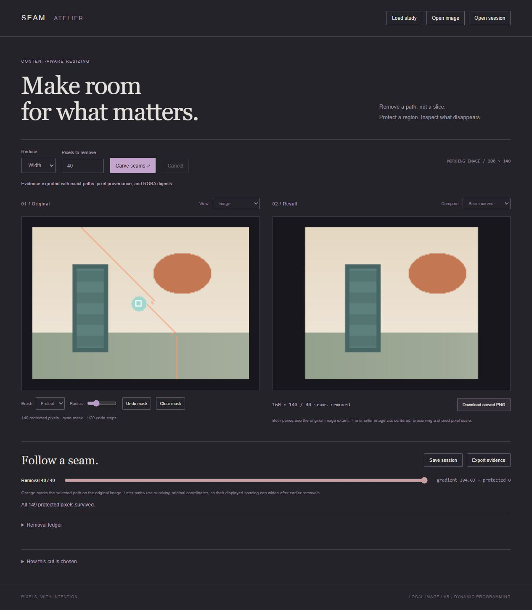

# Seam Atelier

A content-aware image resizing workbench with protection painting, minimum-cost seam inspection, exact pixel provenance, and real PNG exports.



## Run

Requires Python 3.10+. No runtime dependencies, services, or API keys.

```sh
python run.py --port 8000
```

Open http://127.0.0.1:8000/. Image processing runs locally in a cancellable browser worker. Save a session before refreshing.

## Workflows

- Start from the geometric study or import PNG, JPEG, or WebP.
- Paint regions to protect, erase protection, undo the last 20 mask edits, or clear the mask.
- Reduce width or height by up to half its working dimension.
- Compare seam carving with ordinary scaling at the same output dimensions.
- Inspect gradient energy and each removed seam, mapped back onto the original image.
- Export the carved PNG, a reproducible session, or JSON evidence containing all removal paths, surviving original-pixel indices, and input/output RGBA SHA-256 digests.

The [example session](docs/example-session.json) removes 40 vertical seams from a 200 × 140 image while preserving all 149 protected pixels. Its [result](docs/example-result.png) is a real 160 × 140 PNG. Open the session and carve to reproduce it.

Both preview panes retain the original image extent; the resized image is centered inside that extent so their pixel scales agree at equal pane widths. The PNG download always contains the carved image at its actual output dimensions, even when the preview comparison is set to ordinary scaling. Orange seam overlays and cyan mask overlays are inspection aids and are not baked into PNG output.

## Algorithm

For each pixel, the engine computes the square root of the summed squared RGB differences between left/right and upper/lower neighbors. Boundary neighbors are clamped. It adds 1,000,000 for each protected pixel. Dynamic programming finds a minimum-cost top-to-bottom seam whose horizontal position changes by at most one pixel per row. Ties favor the leftmost predecessor and endpoint.

After removing a seam, energy is recomputed on the smaller image. Height reduction transposes the problem and transposes the result back. Every surviving pixel retains its original RGBA bytes; an integer origin map records its position in the working source image. Removal records contain both current seam coordinates and original-pixel indices. For height reduction, ledger working dimensions describe the transposed carving problem.

Protection is a finite penalty. Within the supported dimensions, the penalty exceeds the largest possible unprotected gradient sum of a path. Each seam therefore minimizes protected-pixel crossings first and gradient cost second. If a path avoiding every protected pixel exists at that step, it will be preferred. Repeated removals can make protection crossings unavoidable; every crossing is reported.

This is backward-energy seam carving, based on [Avidan and Shamir, *Seam Carving for Content-Aware Image Resizing*](https://www.merl.com/publications/TR2007-087). It does not implement forward energy, seam insertion, object recognition, or a globally optimal sequence of multiple seams. Straight lines and meaningful content can distort. Use protection and inspect the result.

## Image handling and limits

Imports accept PNG/JPEG/WebP files up to 8 MB. Decoded images over 16 megapixels are rejected after decoding. Accepted images are flattened onto white and scaled down, if necessary, to fit within 256 × 256 working pixels. Exported output uses this working resolution, not the original file's resolution. Color/metadata preservation beyond the browser-decoded RGBA pixels is not provided.

Each carving operation removes 1 through floor(dimension/2) seams on one axis. Sessions are JSON version 1 with exact working RGBA bytes, a binary mask, axis, and count; their import limit is 2 MB. Transparent session pixels are rejected because the model requires opaque RGBA. Masks use one byte per pixel. Protection undo holds up to 20 snapshots.

Pointer painting interpolates brush positions between events. Keyboard users can focus the source canvas, move the cursor with arrow keys, and paint with Space after choosing Protect or Erase. Changing a mask or carving parameter invalidates old output. View changes preserve the result. Computation progress is reported per seam and Cancel terminates the worker.

## Architecture and validation

`core.js` implements validation, gradient energy, dynamic programming, seam removal, transposition, sessions, and provenance. `worker.js` handles cancellable computation and transfers final typed arrays. `app.js` handles canvas interaction, imports, comparisons, and exports. The loopback server exposes only explicit static assets and rejects unexpected Host headers.

Requires Node.js 22+ for JavaScript tests.

```sh
node --test
npm run check
python -m unittest discover -s tests -v
```

Twelve core tests include exhaustive enumeration of 300 small cost grids, analytic gradients, deterministic ties, byte-exact seam deletion, double transposition, horizontal equivalence, avoided and unavoidable protection crossings, original-pixel partitioning, intermediate-seam optimality, session round-trip, progress, source immutability, and invalid inputs. One HTTP test verifies assets, HEAD, hidden-file rejection, and Host validation. CI runs Ubuntu Node 22/24 and Windows Node 24.

Browser checks covered pointer painting, undo, keyboard painting, energy/scaling views, seam scrubbing, PNG/evidence/session downloads, horizontal resizing, exact saved-session replay, and PNG import. An independent Python implementation verified all 40 default exported seam costs, reconstructed output from original indices, decoded and checked every PNG byte, verified both RGBA digests, and counted all 149 protected survivors.
